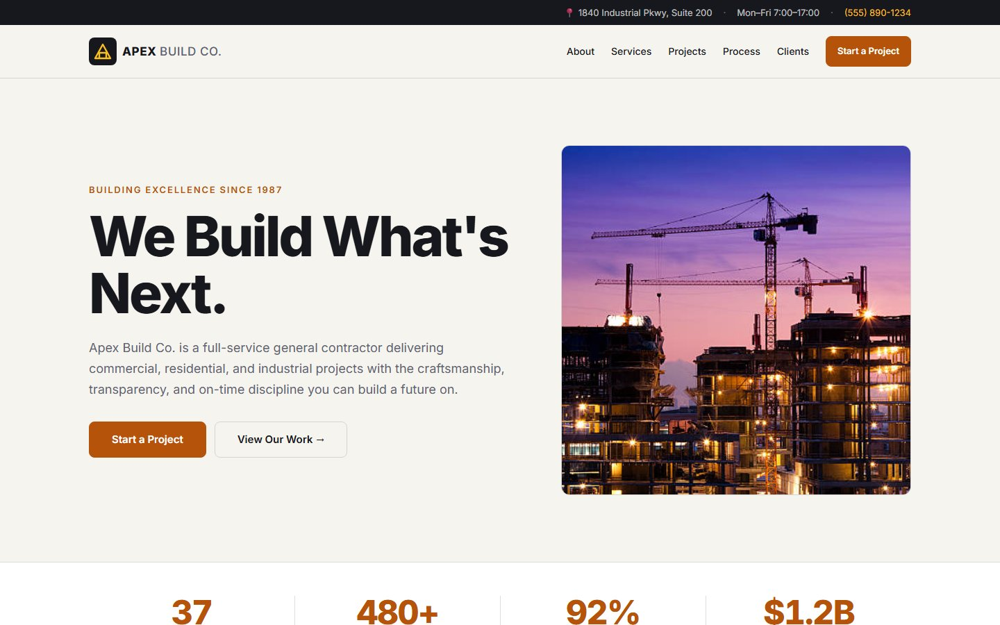

<div align="center">

# 🏗️ Apex Build Co.

**A one-page marketing site for a fictional general contractor — plain HTML, CSS and JavaScript.**


</div>

---

## ✨ Why Apex Build?

A contractor's website needs to answer three questions fast: what do you build, where have you built it, and how do I reach you. Apex Build does that on a single page, with a project grid you can filter by category and a short, direct contact form.

There is no framework and no build step. Everything the page does — the sticky navigation, scroll reveals, animated counters and form validation — is a few lines of vanilla JavaScript. It is a good reminder that not every site needs a toolchain.

### 🧩 What's inside

- 🧭 **Sticky navigation** with a mobile menu.
- 🏢 **About, services, process, testimonials and contact** sections.
- 🖼️ **Project grid** with category filters.
- ✨ **Scroll-reveal sections** and animated stat counters.
- 📝 **Contact form** with required-field checks and an on-page confirmation.

> The form does not send the message anywhere. Submitting it resets the fields and shows a thank-you note on the page.

---

## 📸 Screenshots



---

## 🚀 View it

Open `index.html` in a browser.

Or serve the folder so paths resolve the same way they will when hosted:

```bash
npx serve .
```

---

## 🗂 Files

| File | Role |
| --- | --- |
| `index.html` | Page markup |
| `styles.css` | Layout and motion |
| `script.js` | Filters, reveals, counters and form handling |
| `assets/` | Images |

---

## 🗺 Roadmap ideas

- 📱 Deeper mobile-menu and touch interactions
- 🗺️ A map of service areas
- 📨 Real form submission with validation on the server
- ♿ Automated accessibility checks

---

<div align="center">

No build step, no dependencies. Built with HTML, CSS and JavaScript.

</div>
